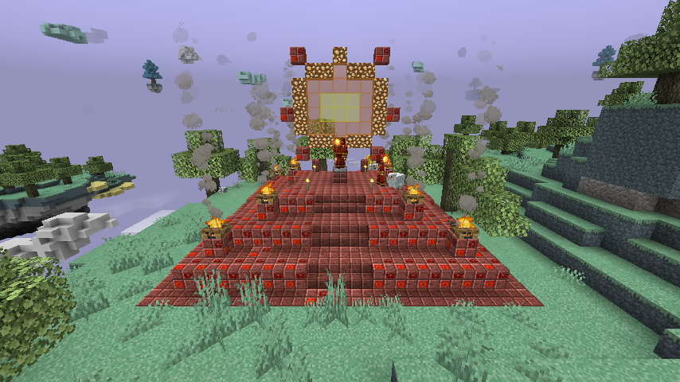

# Aether Spellbooks（天境魔法书）

Iron's Spells 'n Spellbooks × The Aether 联动附属 · 版本 1.1.0 · MIT

- 本目录：Forge 1.20.1。
- [NeoForge 1.21.1 移植版](https://github.com/taisuiyileba/aether_spellbooks/blob/1.21.1/README.md)：独立构建工程与依赖说明。

项目原创代码和素材采用 [MIT License](LICENSE)。依赖模组及运行时引用的第三方素材仍遵循各自许可证。下文的 v1.2～v1.6 标记为开发阶段记录，正式版本统一为 1.1.0。
源码布局、工具入口和验证记录见 [开发文档索引](docs/README.md)，本次更新见 [更新记录](CHANGELOG.md)。

## 依赖
| 模组 | 版本 |
|---|---|
| Forge | 47.4.0+ |
| Iron's Spells 'n Spellbooks | 1.20.1-3.16.0+ |
| The Aether | 1.20.1-1.5.2+（文件名带 neoforge，但可在 Forge 上运行） |

## 常用命令
```bash
./gradlew build               # 输出 build/libs/aether_spellbooks-1.20.1-<版本>.jar
./gradlew runClient           # 开发客户端
./gradlew runGameTestServer   # 运行自动化 GameTest（见下），全部通过时退出码为 0
python tools/item_art.py --check   # 校验法剑和锻造图标；新版美术生成命令见下
ASB_RENDER_CHECK=mobs ./gradlew runClient    # 自动建平坦世界、摆好施法生物、截图到 run/screenshots/asb_*.png 后退出
ASB_RENDER_CHECK=armor ./gradlew runClient   # 同上，展示两套法师盔甲（盔甲架 + 第三人称玩家，带披风）
ASB_RENDER_CHECK=weapons ./gradlew runClient # 同上，展示法杖和法剑（物品展示框、第三/第一人称、物品栏图标）
ASB_RENDER_CHECK=books ./gradlew runClient   # 法术书与铁魔法参考对照、环绕、左右手及第三人称截图
ASB_RENDER_CHECK=slider ./gradlew runClient  # 幽冥锤攻击滑行魔石的正面和侧面连续帧
ASB_RENDER_CHECK=accessories ./gradlew runClient # 右键装备和天境饰品界面拖放检查
ASB_RENDER_CHECK=items ./gradlew runClient   # 同上，生存背包里把本模组图标和铁魔法/Aether/原版的同类物品排在一起对比
ASB_RENDER_CHECK=spells ./gradlew runClient  # 同上，对一排尸壳依次施放 v1.5 的法术并在关键时刻截图（asb_spell_*.png）
ASB_RENDER_CHECK=shrines ./gradlew runClient # 同上（这个场景会开启结构生成），平坦世界里放置两座神殿，再去 Aether 找自然生成的神殿截图（asb_shrine_*.png）
```

## 从 1.21.1 同步的美术与饰品改动

本版本同步了 NeoForge 1.21.1 当前工作区的美术资源和后续渲染修复，包括五把法杖的 3D 模型与图集、武神权杖的立体羽翼、两套法师甲的模型与动画、法剑和盔甲图标、施法生物皮肤、投射物和四组粒子。保留四件饰品的原有手绘图标。25 张动画贴图包含宝石闪烁、符文脉动和披风流光；披风、雷晶和烈阳核心由 GeckoLib 主动推进动画。羽毛按往返帧序翻动，境云粒子靠近第一人称镜头时淡出，发光投射物使用固定向上的法线，保持不同视角下的亮度。

1.20.1 的天境饰品栏和通用饰品栏都通过 Curios 实现。四件饰品分别支持 `aether_ring`／`ring`、`aether_pendant`／`necklace`、`aether_gloves`／`hands`、`aether_cape`／`back`，可右键装备或在界面拖放；两套槽位提供相同属性，项链施法磨损和披风减伤均适用。天境界面只显示其自身槽位，通用槽位需通过 Curios 界面查看，且需由其他模组或整合包配置提供。四件饰品也支持泛用 `curio` 槽，在其中提供完整属性、项链磨损和披风减伤；不匹配的专用槽位不会触发这些效果。本附属只声明适用槽位；测试时提供的通用槽位数据包不会进入发布 JAR。

当前资源由以下五个脚本重建；均支持 `--check`，仅校验已导出资源：

```bash
python tools/build_spellbook_models.py --check
python tools/item_art.py --check
python tools/staff_models.py --check
python tools/armor_art.py --check
python tools/entity_art.py --check
```

省略 `--check` 即生成资源与 `build/art_preview/` 中的预览。早期美术和初始化数据脚本已归档至 `tools/legacy/`，会覆盖当前资源，不用于重建 1.1.0。神殿模板仍由 `tools/gen_structures.py` 管理。工具分类和依赖见 [工具说明](tools/README.md)。

## 内容（1.1.0）
### 法术（16 个）
| 法术 | 学派 | 地牢档次 | 要点 |
|---|---|---|---|
| 云阶术 `aercloud_step` | 唤魔 | 铜 | 临时境云平台；3 级起中心为弹跳蓝云，4 级起附带缓降 |
| 碎岩飞刃 `stonebreaker_shard` | 自然 | 铜 | 翻滚的圣石块；**能打滑行魔石**；命中减速；5/9 级齐射 2/3 发，7 级起穿透 |
| 西风冲击 `zephyr_blast` | 唤魔 | 铜 | 风球爆开，范围击退，适合把敌人吹下浮岛 |
| 风暴雷球 `thunder_crystal` | 雷电 | 银 | 追踪雷晶；3 级起电弧连锁 1~2 个额外目标 |
| 召唤恐鸟 `summon_moa` | 唤魔 | 银 | 自动骑乘；蓝/白/黑恐鸟对应 3/4/8 次连跳 |
| 武神突进 `valkyrie_lunge` | 神圣 | 银 | **连段冲刺**（1-2/3-5/6 级为 2/3/4 段，3 秒内再次施放，法力只扣一次）：每段打击并**烙印**路径上的敌人（发光 4 秒），穿过带烙印的敌人消耗烙印造成 +50% 伤害；最后一段落地时释放**武神裁决**冲击波（80% 伤害，把周围敌人掀起，同样引爆烙印），在空中低头施放可俯冲而下 |
| 境云护卫 `cloud_sentinels` | 唤魔 | 银 | 两只 Aether 迷你云护卫，朝准星上的敌人开火，施法时追加一轮齐射 |
| 天境旋风 `aether_whirlwind` | 自然 | 银 | 会追猎敌人的移动旋风，把敌人卷上天 |
| 冰结球击 `frostbound_crystal` | 冰霜 | 金 | 真正的 Aether 冰结球；**能冻结烈阳巨灵**；命中施加冰寒，带霜雪拖尾 |
| 召唤烈焰奴仆 `summon_fire_minion` | 火焰 | 金 | 奴仆消散或死亡时爆燃，造成范围伤害 |
| 重力涌动 `gravitite_surge` | 末影 | 金 | 把周围敌人抛起，0.8 秒后逆转重力砸回地面（带镜头震动） |
| 烈阳耀斑 `solar_flare` | 火焰 | 金 | 头顶出现迷你烈阳，自动朝敌人发射追踪火弹。每发 4/5/6 伤害，1/2/3 级持续 7/9/11 秒，3 级理论总输出约 75，点燃 2 秒 |
| 光辉圣枪 `radiant_javelin` | 神圣 | 银 | 蓄力掷出武神长枪（直接使用 Aether 的武神长枪模型），**贯穿所有敌人**；插进地面后爆发圣光之柱：60% 范围伤害并掀起敌人，同时治疗自己和盟友。武神术士也会用 |
| 雷暴境云 `thunderhead` | 雷电 | 银 | 在瞄准处聚起雷暴云，追着附近的敌人飘移，每 1.4-0.9 秒（随等级）向正下方的敌人落雷（自绘分叉闪电），闪电再跳到附近 1 个敌人（50%）；**潮湿/雨中的目标 +50%**；被屋顶挡住时不会落雷 |
| 天鲸之歌 `aerwhale_song` | 自然 | 银 | 召来半透明的灵体天鲸（Aether 自己的天鲸模型）从身后游过头顶，一路 7 段歌声：伤害并震起下方敌人，给下方的自己和盟友 4 秒缓降 + 跳跃提升 II，方便跨浮岛 |
| 冰石陨落 `icestone_meteor` | 冰霜 | 金 | 从天空砸下一块翻滚的冰石巨岩（地面先出现预警圈），落点冰寒爆炸：中心满伤、边缘 60%，冻结并冰寒、击退；像冰石一样把附近的水面冻成会融化的霜冰 |

### 施法生物（v1.2，v1.6 起住在神殿里）
使用铁魔法的通用人形施法模型和 AI（`WizardAttackGoal`），皮肤与附加渲染层为本模组原创。两者互不伤害。
**v1.6 起和铁魔法的其他术师一样，只在自己的神殿里出现**：神殿所在区块生成时，模板里存的两名术师随结构一起生成，并且不会自然消失。默认不再在 Aether 地表随机刷新；想恢复可以把配置 `valkyrieSorceressNaturalSpawnWeight` / `solarAcolyteNaturalSpawnWeight` 调回 3 / 2（旧版本配置里的 `...SpawnWeight` 键已改名，升级后会按新默认值 0 处理）。

| 生物 | 生命/护甲 | 法术 | 特色 | 掉落 |
|---|---|---|---|---|
| 武神术士 `valkyrie_sorceress` | 60 / 6 | 攻击：风暴雷球、光辉圣枪、西风冲击、铁魔法曳光弹；防御：重力涌动（目标进入范围才放）；位移：武神突进；辅助：治疗、喝药；开战先放一次神圣守护 | 羽翼渲染层：落地收拢、下落时扇动、施法时展开；空中滑翔（下落速度 ×0.6，无摔落伤害）并掉落羽毛；目标在高处时振翅跃上平台 | 胜利奖牌（75%，抢夺 +10%，**让法师也能攒够挑战武神女王的奖牌**）、神能晶片 1-3、奥术精华 1-3、雷电/神圣系卷轴（30%）、卓越/稀有墨水（30%）、雷霆/神圣符文（20%）、升级锻造模板（12%） |
| 烈阳祭司 `solar_acolyte` | 50 / 2 | 攻击：火焰箭、烈焰风暴；防御：焰涌；位移：烈焰冲锋；每 20~30 秒点燃一次烈阳耀斑；开战召唤一次烈焰奴仆 | 头后缓慢旋转的金色日轮（叠加发光的日冕和核心）、施法时日轮增亮；眼睛和胸前日纹自发光（GeckoLib glowmask）；身边飘火星；死亡时爆出火光 | 金琥珀 2-4、神能晶片 1-3、奥术精华 1-3、烈阳耀斑/烈焰奴仆/冰石陨落卷轴（30%）、炽焰符文（20%）、稀有墨水（15%）、升级锻造模板（12%） |

配套：两种刷怪蛋（也会出现在原版刷怪蛋标签页）、中英文名称。v1.6 调整掉落：术师不再到处刷，每只都更值钱（上表均为抢夺前的概率）。

### 术师神殿（v1.6）
两座新的 Aether 结构，只生成在浮岛上平坦、够厚的地面上（自定义结构类型 `aether_spellbooks:island_shrine`：先在区块内几个候选点采样占地中心和四角的地面高度，排除虚空、岛边薄壳和坡度过大的地方，再用原版 jigsaw 放置模板，所以处理器、地形过渡和模板里的实体都照常工作）。会避开 Aether 的银/金地牢，`/locate structure aether_spellbooks:...` 可以找到。

| 结构 | 外观 | 守卫 | 奖励箱 |
|---|---|---|---|
| 武神圣所 `valkyrie_sanctum`（19×11×19，间距 14 区块） | 圣石砖地基上的八角形神殿：八根 Aether 石柱、天使石地面、圣石砖阶梯穹顶和天窗、发光的亮天使石环带，中央祭坛、天境木书架和讲台，四周飘着冷境云；部分石块随机风化成苔圣石 | 2 名武神术士 | 4-7 组材料（神能晶片、紫晶石、奥术精华、白苹果、金羽毛、墨水、神圣/雷霆符文、神圣珍珠、治疗石），银档法术卷轴（85% + 35%），45% 出一件特殊奖励（升级模板、武神权杖、神能法戒、武神法者披风、武神圣典），50% 胜利奖牌 1-2 |
| 烈阳祭坛 `solar_altar`（17×13×17，间距 17 区块） | 四层狱火石阶梯金字塔，四面都有台阶，火盆（营火）分布在各层，顶端是 Aether 的太阳祭坛，背后竖着荧石日轮和彩色玻璃日核 | 2 名烈阳祭司 | 4-7 组材料（金琥珀、神能晶片、奥术精华、烈焰粉、附魔重力晶、稀有/史诗墨水、炽焰/寒冰符文、治疗石），金档卷轴 85%、金/银档卷轴 35%，45% 出一件特殊奖励（升级模板、烈阳权杖、紫晶律动项链、重力晶施法护手、烈阳法典） |

生成位置、战利品、处理器都是数据驱动的，可以用数据包覆盖（`worldgen/structure`、`worldgen/structure_set`、`loot_tables/chests/*`）；模板由 `python tools/gen_structures.py` 生成。




创造物品栏还提供全部 16 个法术从最低级到最高级的卷轴；生存模式下从对应档次的天境地牢战利品和部分生物掉落中获得。

### 法师盔甲（v1.3）
把 Aether 的武神套和凤凰套在锻造台上升级成铁魔法风格的法师套：**天境奥术升级锻造模板 + Aether 盔甲 + 符文**（武神用神圣符文，凤凰用炽焰符文），附魔和耐久会保留下来。

| 套装 | 每件属性 | 继承自 Aether 的套装效果 | 法师套额外效果 |
|---|---|---|---|
| 武神法者（战盔 / 铠甲 / 护腿 / 战靴） | 护甲 3/8/6/3，韧性 2；最大法力 +125，神圣强度 +10%，雷电强度 +5% | 空中按住跳跃可短暂飞行（与原版相同的计时和上升曲线，共用 Aether 的玩家数据），免疫摔落伤害 | 武神之佑：身在空中时施法时间 -15%；飞行时洒落羽毛和星光 |
| 凤凰法者（兜帽 / 长袍 / 护腿 / 长靴） | 护甲 3/8/6/3，韧性 2；最大法力 +125，火焰强度 +10%，火焰魔抗 +5% | 免疫火焰与熔岩（法术伤害除外），在熔岩中快速游动，周身环绕火焰；**不会**再在水中变成黑曜石，只会冒出蒸汽 | 涅槃：受到致命伤害时浴火重生，恢复 40% 生命、清除负面效果，并灼烧、击退 4.5 格内的敌人；冷却 5 分钟，冷却会显示在四件盔甲上 |

铁魔法盔甲的特性都有：胸甲可以用奥术铁砧镶入一个法术；每一件都能用升级宝珠强化；加入了 `irons_spellbooks:armors/*` 和 `forge:armors/*` 标签。
- **3D 模型**（GeckoLib，沿用铁魔法的 `GenericCustomArmorRenderer`）：武神套为带蓝宝石的开面战盔，两侧羽翼随动画扇动，搭配银白护甲与金边蓝色腰带；凤凰套为开脸羽毛兜帽，保留中间火冠，面罩开口从眉线开始，穿戴时不会遮住眼睛。两套使用 128×128 图集与独立的披风，羽翼和冠羽从多个视角均有立体厚度；头盔、胸甲与护腿图标为正面构图，靴子图标的脚尖分别朝外，轮廓左右对称。
- **披风**：两套胸甲都自带披风（白金蓝的武神披风 / 渐变火焰、下缘镂空成火舌的凤凰披风）。它和原版披风一样随动作摆动，但挂在盔甲外侧不会穿模；玩家自己有披风时优先显示玩家的。
- 模板获取：银牢奖励箱 35%、金牢奖励箱 50%，武神术士和烈阳祭司 3%（抢夺 +1%）；可以用 7 个奥术精华加 1 个神炼重力晶矿复制（一次得 2 个）。
- 所有新物品都写了 Aether 知识之书（Book of Lore）里的介绍。

### 法杖与法剑（v1.4）
**法剑**是铁魔法的魔法剑（`MagicSwordItem`）：伤害和攻速与 Aether 原剑相同（7 / 1.6），剑里封存着一个法术（出现在法术轮盘里），手持时增加对应学派强度 +10% 和最大法力 +50，并继承原剑的能力（和 Aether 一样只在蓄满力的攻击时触发）。用同一张天境奥术升级锻造模板加对应符文，在锻造台上升级而来，附魔会保留。

| 法剑 | 升级自（+ 符文） | 封存法术 | 继承能力 |
|---|---|---|---|
| 烈阳法剑 `sunfire_spellblade` | 烈焰长剑 + 炽焰符文 | 烈阳耀斑 Lv2 | 点燃目标 30 秒（火焰附加每级 +4 秒） |
| 唤雷法剑 `stormcaller_spellblade` | 疾电长剑 + 雷霆符文 | 风暴雷球 Lv4 | 在目标处召下落雷（不会劈到自己） |
| 圣辉法剑 `hallowed_spellblade` | 神圣巨剑 + 神圣符文 | 武神突进 Lv4 | 对亡灵额外造成 8.25 伤害（亡灵杀手每级 +2.5） |
| 血契法剑 `sanguine_spellblade` | 吸血魔剑 + 猩红符文 | 猩红斩击 Lv4（铁魔法） | 命中时恢复半颗心 |

**法杖**是铁魔法的法杖（`StaffItem`）：右键释放当前选中的法术，主手持有时提供属性加成。使用 3D 模型，在物品栏里斜向显示。

| 法杖 | 获取 | 近战 | 主手加成 | 特色 |
|---|---|---|---|---|
| 紫晶法杖 `zanite_staff` | 合成（紫晶石、奥术精华、天根木棍）；铜牢箱 8% | 3 | 法术强度 +10%，法力回复 +15% | 入门法杖 |
| 境云法杖 `aercloud_staff` | 锻造：境云权杖 + 唤魔符文 | 3 | 唤魔 +15%，施法时间 -10%，法术强度 +5% | 继承境云权杖：潜行使用时召唤或解散两只迷你云护卫，挥动法杖让它们开火 |
| 重力晶法杖 `gravitite_staff` | 合成（紫晶法杖、神炼重力晶矿、末影符文） | 5 | 末影 +15%，冷却 -10%，法术强度 +5% | 继承重力晶武器：蓄力一击把地上的目标抛上天 |
| 武神权杖 `valkyrie_scepter` | 银牢奖励箱 20% | 5 | 神圣 +15%，雷电 +10%，法术强度 +5% | 杖头飘出金色星光 |
| 烈阳权杖 `solar_scepter` | 金牢奖励箱 20% | 6 | 火焰 +15%，施法时间 -10%，法术强度 +10% | 日轮杖头飘出火星 |

- 3D 模型由 `tools/staff_models.py` 生成。法杖在背包、展示框、手持和地面上都使用立体模型；武神权杖每侧有覆羽肩部和四根交叠的实体羽毛。
- 杖头粒子只在别人看你或第三人称时出现，第一人称下不会挡视线。
- 法剑加入了 `minecraft:swords` 和 `forge:tools/swords` 标签。

### 物品
| 物品 | 槽位 | 效果 | 获取 |
|---|---|---|---|
| 魔石法典 / 武神圣典 / 烈阳法典 | 法术书 | 8/10/12 槽，附带对应学派加成 | 铜/银/金地牢奖励箱 |
| 神能法戒 | `aether_ring` / `ring` | 法力回复 +15% | 配方；银牢 |
| 紫晶律动项链 | `aether_pendant` / `necklace` | 法术强度 +5%→+20%，越磨损越强 | 配方 |
| 重力晶施法护手 | `aether_gloves` / `hands` | 施法时间 -10%，末影强度 +8% | 配方；金牢 |
| 武神法者披风 | `aether_cape` / `back` | 神圣强度 +10%，最大法力 +50，摔落伤害减半 | 配方；银牢 |

### 特效
- 4 种自定义粒子：羽毛 `feather`、星光 `sky_sparkle`、境云 `cloud_puff`、重力微粒 `gravity_mote`
- 专用渲染器：翻滚的圣石块（碎岩飞刃）、带光晕的发光八面体（风暴雷球）、三层叠加的迷你烈阳（烈阳耀斑）、带光晕的精灵图（火弹、风球）
- 复用铁魔法的冲击波环、电弧、火花、方块碎屑粒子和镜头震动；音效复用 Aether 的 Boss、恐鸟、云护卫等音效

### 其他
| 类型 | 内容 |
|---|---|
| Boss 联动 | 碎岩飞刃的投射物加入了 `aether:slider_damaging_projectiles`；冰结球击生成真正的 `IceCrystal`，能触发烈阳巨灵的冻结机制 |
| 战利品 | 通过 `irons_spellbooks:append_loot` 注入铜/银/金地牢箱、女武神和西风啸云的掉落；新法术默认只在 Aether 掉落（配置项 `aetherExclusiveSpells`） |
| 可选数据包 | `aether_spellbooks:ice_magic_is_cold`（默认关闭）：开启后铁魔法所有冰系法术都能伤害未冻结的烈阳巨灵 |
| 数据维护 | 当前战利品、标签与配方以 `src/main/resources/data/` 为准；早期初始化脚本归档于 `tools/legacy/` |

## 法术书模型（1.20.1）

魔石法典、武神圣典和烈阳法典的 3D 模型参考铁魔法的冰霜、金制和烈焰法术书，以每模型单位 1 像素、7×10 像素封面重绘。分别保留灰蓝石面与青色眼纹、蓝色皮面与银白羽翼、暗红皮面与金黄太阳，使用成片的材质明暗和铜／金包角。合书外形为 4×7×10，封皮厚度为 1，书页内收 1，与铁魔法常规书籍的体量一致。32×32 图集为封面、背面、内衬、书脊及书页分配独立 UV；原 16×16 背包图标保持不变。

左右手持显示正面纹饰，第一人称略微缩小、上移，展示框朝向与展开模型同步修正。可重建的图集和模型源脚本为 `tools/build_spellbook_models.py`（需要 Pillow），带 `--check` 参数时只校验导出资源。运行 `ASB_RENDER_CHECK=books` 可生成与铁魔法参考书同尺度、同光照的实机对照、36 帧环绕记录以及左右手和第三人称截图。检查辅助类不进入发布 JAR。

资源与检查记录见 [法术书模型说明](docs/spellbook_models.md)。

## 铁魔法与滑行魔石联动

- **投掷**：扔出的镐子及其他符合天境挖掘工具规则的物品可以唤醒并伤害滑行魔石。投掷工具的伤害为 **法术伤害 + 该工具的攻击伤害**，支持主手／副手、锋利附魔及力量等攻击属性加成；不会借用另一只手中武器的攻击力或重复叠加。物品与伤害在发射时确定，换手或修改原物品不影响飞行中的投射物。普通物品不会因此获得破防能力。
- 无额外加成时，一级投掷的木／石／铁／钻石／下界合金镐面板伤害分别为 **3 / 4 / 5 / 6 / 7**。实际伤害继续经过目标抗性和天境的 `tools_debuff` 规则；默认情况下，天境还会削弱外来投射物，因此实际扣血可能低于面板数值。
- **幽冥锤**：可以直接瞄准 16 格内的滑行魔石施放，复用原有锤子模型、动画和音效，按原动画中锤头下缘的位置对齐滑行魔石顶面，在第 13 tick（约 0.65 秒）落锤时结算一次伤害。生成时锁定挥击方向，尚未消失的锤子特效不阻挡后续施法。目标离开落点、出现墙体遮挡或施法者离开地牢房间时会落空。攻击分支不会挖掉周围方块，普通挖矿用法保持原样。
- 幽冥锤默认基础伤害为 **6 / 8 / 10 / 12 / 14**，受法术强度、唤魔强度、铁魔法的法术倍率配置和目标抗性影响。法术详情新增中英文滑行魔石伤害提示。
- 保留天境的和平难度、地牢房间边界、首次命中唤醒并回满生命、仇恨和受击流程；幽冥锤仍遵守冒险模式限制。碎岩飞刃等既有兼容继续生效。

配置位于 `config/aether_spellbooks-common.toml`；修改后重启游戏／服务器生效：

```toml
[sliderCompatibility]
thrownToolsDamageSlider = true
spectralHammerDamageSlider = true
hammerBaseDamage = 6.0
hammerDamagePerLevel = 2.0
```

联机时以服务端数值为准，客户端使用相同配置可保持法术详情显示一致。兼容通过本附属的四个 Mixin 实现，不需要替换天境或铁魔法的 JAR。

## 自动化测试（65 项，不会打进 jar）

- `ASAccessoriesGameTests`（7 项）：两套对应槽位与泛用 `curio` 槽的装备、属性和主动效果；通过正常玩家 tick 验证四件饰品的实际属性添加与卸下后的移除，以及项链施法只磨损一次、磨损后实际加成增长、耗尽后移除加成、修复后恢复加成和披风减伤；强制放入不匹配的专用槽位时不会磨损或减伤。
- `ASSliderCompatGameTests`（14 项）：真实投掷与换手、工具材质和实际扣血、副手附魔与物品快照、力量加成且不重复计算武器属性；幽冥锤起手、唤醒、单次伤害、射程／遮挡、冒险／和平、房间边界、移动目标、配置开关及原有挖矿。
- `ASGameTests`：云台、Slider 联动、烈阳巨灵冻结、召唤恐鸟、烈焰奴仆结盟、Aether 独占、金牢战利品、配方与可选数据包
- `ASSpellGameTests`：重力涌动先抛起再砸地、武神突进路径伤害、西风冲击击退方向、旋风卷起并造成伤害、烈阳耀斑自动开火、境云护卫数量、碎岩飞刃齐射与穿透、风暴雷球电弧连锁、冰结球击跟随准星俯仰角
- `ASV15SpellGameTests`：烈阳耀斑总伤害上限；武神突进可再次施放、烙印后第二段 +50% 伤害并消耗烙印、最后一段落地冲击波；光辉圣枪贯穿两名敌人并在落点爆发；雷暴境云向下方敌人落雷；天鲸之歌伤害/震起敌人并只给盟友缓降和跳跃提升；冰石陨落伤害、冻结、冰寒并把水冻成霜冰
- `ASMobGameTests`（单独批次）：武神术士和烈阳祭司都会对目标施法并造成伤害、武神术士滑翔落地无摔伤、默认不再自然刷新（刷怪表跟随配置）、战利品表能正常掷出、两者互为盟友
- `ASArmorGameTests`：凤凰法者套免疫火焰/熔岩（没穿的对照组会受伤）；涅槃触发一次、恢复 40% 生命、点燃旁边的敌人，第二次致命伤害时正在冷却；武神法者套免疫摔落；空中按住跳跃会被抬升，武神之佑在空中生效、落地后移除；每件的铁魔法属性只在对应槽位生效；锻造升级保留附魔、符文用错不能升级、模板可以复制
- `ASWeaponGameTests`：烈阳法剑点燃目标约 30 秒；圣辉法剑对亡灵的额外伤害（与普通生物对比）；唤雷法剑召下落雷；血契法剑回血；三把法剑都封存着正确的法术；手持属性只在主手生效；重力晶法杖把地上的目标抛起；境云法杖召唤两只迷你云护卫；五种锻造升级和两个合成配方
- `ASShrineGameTests`（单独批次）：两座神殿的模板里各有两名对应的术师（不会消失）和带正确战利品表的箱子；两个箱子每次至少掷出 4 组物品；两座神殿都能在 Aether 里自然生成并被找到
- `ClientRenderCheck`：开发用的客户端截图检查（见“常用命令”），实机效果图存在 `docs/screenshots/`。`accessories` 场景另通过真实客户端与服务端的网络同步，验证泛用槽中项链的装备、磨损、耗尽、修复、卸下五个阶段的耐久和实际法术强度一致；成功时日志输出 `[ASB-ACC-SYNC] all 5 stages passed`。

Forge 发布 JAR 使用 MixinGradle 生成的 refmap 映射幽冥锤 `tick` 方法，并在清单中注册 Mixin；开发截图、GameTest 类及开发用通用槽位数据包不打入发布包。验证记录见 [1.21.1 改动回移记录](docs/backport_1.21.1.md)。

1.20.1 实机记录：[法术书](docs/screenshots/asb_books_comparison.png)、[幽冥锤正面](docs/screenshots/slider_hammer_front.gif)、[幽冥锤侧面](docs/screenshots/slider_hammer_side.gif)。

## 还需要进游戏手动检查的项目
- 所有投射物和特效的实际观感（翻滚的圣石块、发光雷晶、迷你烈阳、旋风粒子）
- 恐鸟的空中连跳手感；下坐骑 5 秒后是否消散
- 武神突进的冲刺距离手感（按速度推进，地面上会比空中短一些）
- 法术书挂在腰间的 Curios 装备效果（独立的合书／展开模型）
- 饰品在多人联机时的装备和同步手感
- 神殿在不同种子下的实际密度（间距 14 / 17 区块，在 GameTest 世界里离原点最近的约 20~900 格）和两名术师一起上时的难度
- 武神法者套的飞行手感（逻辑和 Aether 原版相同，但需要在联机服务器上确认不会被判定为飞行）
- 法师盔甲在各种动作（潜行、游泳、鞘翅）下的模型和披风表现
- 法杖在第三人称里的持握姿势（使用铁魔法的法杖手臂姿势；盔甲架没有这个姿势，会横着拿）
- 平衡性数值（全部可以通过铁魔法的 spell_config 或本模组配置覆盖）

## 素材授权
Aether 和铁魔法的美术素材都是**保留所有权利**。本模组当前美术由 `tools/item_art.py`、`tools/staff_models.py`、`tools/armor_art.py`、`tools/entity_art.py`、`tools/build_spellbook_models.py` 原创生成，四件饰品保留原有手绘图标；法术书使用 32×32 独立 UV 图集，法杖使用 64×64 面图集，法师甲使用 128×128 图集，施法生物沿用标准 64×64 玩家皮肤布局。施法生物直接使用铁魔法运行时自带的人形模型，云块、烈焰奴仆、恐鸟在运行时直接使用 Aether 自己的模型和渲染器，没有复制其模型文件。

饰品泛用槽修复及实际属性、客户端同步检查说明见 [饰品实际属性与同步验证](docs/accessory_effects_fix.md)。
